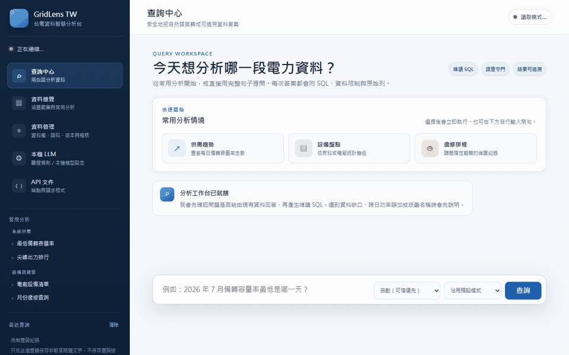
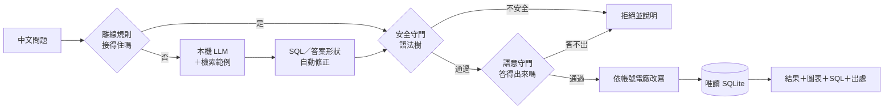
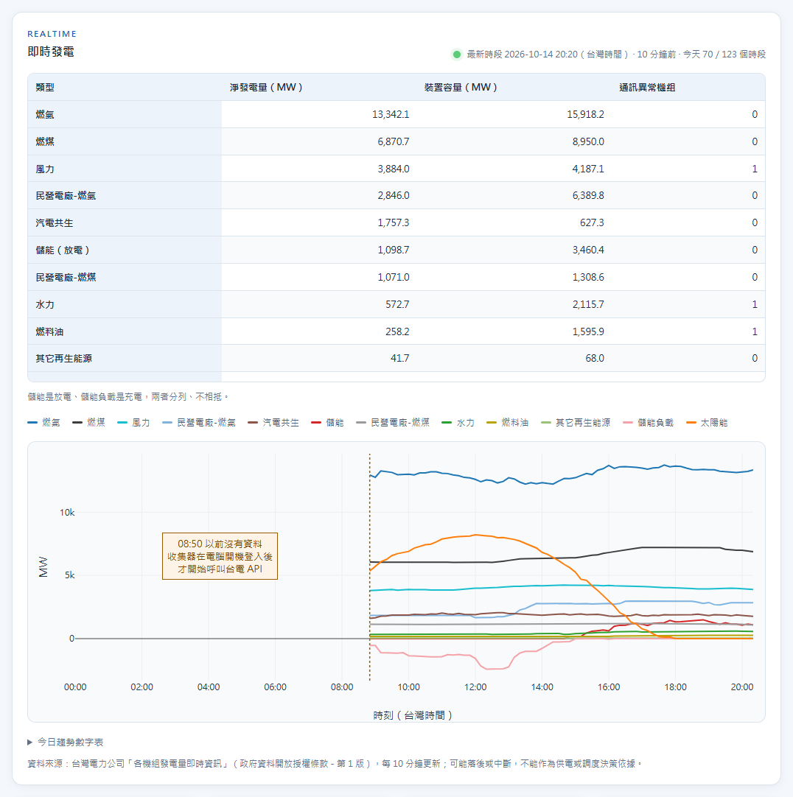

# GridLens TW｜用中文查台電資料的地端 Text2SQL 系統

用中文問台灣電力資料，系統產生 SQL、查詢並畫圖回答，並告訴你**這份資料能不能支持這個答案**。
規則、檢索、語言模型全在本機執行，不需要 API key，資料不出這台電腦。

> **English** — Local-first Text2SQL over Taiwan Power open data. Deterministic rules answer most questions; the long tail
> goes to a local LLM (Ollama `qwen3:8b`) behind an AST SQL guard and a semantic guard. Includes an LLM evaluation with
> held-out question sets and significance tests, a three-model and a retrieval (n-gram vs embedding) comparison,
> an MCP server for agents, a realtime collector, and a Docker demo.


-1a5fb4)




**線上展示：<https://gridlens-tw.onrender.com>**（只用規則；免費方案閒置會休眠，第一次開約需一分鐘）

```bash
docker build -t gridlens-tw . && docker run --rm -p 8000:8000 gridlens-tw   # 本機跑，開 http://127.0.0.1:8000/
```

## 重點

| | 成果 |
|---|---|
| 守門 | SQL 攻擊 16／16 攔截、正常問題 0／20 誤攔；語意陷阱 45／45 正確拒答或揭露限制 |
| 規則路徑 | 意圖 80／80、執行 60／60，可重現、不需要模型 |
| 本機 LLM | 規則答不出的長尾，三輪各用**動手前寫好的新題庫**計分：14→21、10→15、15→20；合併 McNemar p ≈ 0.00002 |
| 選型有數據 | 3 個本機模型與 3 種檢索方式，在 121 題上逐題配對比較後才定預設 |
| 給 AI 代理用 | MCP server：代理只能送中文問題、不能送 SQL，走同一條守門 |
| 工程 | 1,408 項測試、CI 全程離線（含 Docker 建置）、每步可回退的紀錄（[log.md](log.md)） |

**技術**：Python · FastAPI · SQLite · sqlglot · Ollama · RAG（n-gram／bge-m3／RRF）· LLM guardrails · MCP ·
評測設計與統計檢定 · pytest · Docker · GitHub Actions

## 為什麼重點是守門

問「2025 年台灣太陽能發了多少度？」查得到數字，但那份資料只收台電**自建**場站，約佔全國 **3～4%**。
數字看起來正常，使用者不會察覺。所以系統不只翻譯 SQL：算不出來的題目擋下並建議問法，有範圍限制的照答並把限制寫在旁邊。



- **安全守門**：sqlglot 拆語法樹，只准單一 SELECT、只准查審核過的語意檢視、值一律走參數。
- **語意守門**：拒答／揭露限制／請你講清楚三級；資料陷阱寫在資料庫裡，不靠提示詞。
- **權限在後端**：SQL 通過檢查後才依帳號改寫，模型繞不過去。

## 本機 LLM 評測

只收「規則答不出、資料答得出」的題目，比對查詢結果的值。每輪修正前**先另寫一份新題庫**當成績，照錯修過的題庫只當參考。

| 輪次 | 修了什麼 | 新題庫成績 |
|---|---|---:|
| 1 | 答案形狀（問「有幾座」卻列清單、問「各」卻只回總數） | 27 題 14 → **21** |
| 2 | 去重、第 N 名、「同時有 A 和 B」、模型編出的電廠名 | 26 題 10 → **15** |
| 3 | 拿掉模型自己加的條件、多送的參數 | 28 題 15 → **20** |

**選型**（同一條管線、五份題庫共 121 題，逐題配對，[比較表](reports/llm/model_comparison.md)）：

| 模型 | 答對 | 每題秒數 | 對 qwen3:8b |
|---|---:|---:|---|
| `qwen3:8b`（預設） | **102** | 12.8 | — |
| `qwen2.5-coder:7b` | 92 | **2.1** | p = 0.11，不顯著 |
| `qwen3:4b` | 67 | 1.0 | p < 0.001，明顯較差 |

學到的事：
- **中間指標變好 ≠ 端到端變好**：bge-m3 embedding 讓檢索 Hit@1 從 49% 升到 69%，但答對數沒變（p = 0.66），每題還慢 5～10 倍，所以預設仍用 n-gram。
- **能用程式修的錯就別退回給模型**：8B 模型被退回時常原樣再送；SQL 修正只處理寫法唯一的錯，有兩種改法時不猜。
- **推理模式不是更準，是更少答錯**：48 題兩者都答對 39，但推理開只答錯 1 題（推理關 8 題），代價是慢 20 倍。
- **小題庫要檢定**：單輪只改對 5 題時 p = 0.062，無法排除運氣；28 題的準確率 95% 區間寬達 53%～85%，所以只說「大約六到七成」。

完整過程：[docs/LLM_EVALUATION.md](docs/LLM_EVALUATION.md)。

## 給 AI 代理用：MCP server

`python -m serving.mcp_server` 把查詢開成 [MCP](https://modelcontextprotocol.io) 工具，Claude Desktop／Claude Code 可直接問台電資料。
工具**只收中文問題、不收 SQL**，三個工具都標成唯讀。設定與設計：[docs/MCP.md](docs/MCP.md)。

## 其他功能



- **即時發電**：每 10 分鐘收集 204 個機組，原始回應先封存再入庫、壞了能重建；面板與「現在風力發多少」這類問句都附資料時間。
- **權限與治理**：帳號綁電廠只看得到本廠；資料上線要另一人核准、可回退、稽核紀錄成雜湊鏈。
- **部署**：Docker 映像（非 root、健康檢查、只跑規則）與 Render Blueprint，見 [docs/DEPLOY.md](docs/DEPLOY.md)。

## 和原專題的關係

基於 [lee851104/text2sql_project](https://github.com/lee851104/text2sql_project) 延伸開發。原專題提供資料對齊、管線、
雙層守門與帳號治理的基礎；以下是我新增或重寫的部分（commit 都查得到）：
改成全程地端、LLM 評測與三輪修正（[SQL 修正](src/text2sql/sql_repair.py)、[答案形狀修正](src/text2sql/answer_shape.py)）、
統計檢定與模型／檢索比較、即時發電收集到查詢、MCP server、Docker 部署，以及歲修、核能、再生能源的規則擴充。

## 快速開始

```bash
make setup && make db && make serve                      # 安裝、建資料庫、啟動 http://127.0.0.1:8000
uv run powerquery "2026年7月備轉容量率最低是哪一天？"      # CLI
make test-all                                            # 全套測試（不需要 Ollama）
```

要用本機模型：安裝 [Ollama](https://ollama.com) 並 `ollama pull qwen3:8b`，沒開時自動只用規則。
Windows 可直接點兩下 `啟動.bat`。帳號、執行模式與 API 見 [docs/SERVING.md](docs/SERVING.md)。

## 文件

| 想知道 | 看這裡 |
|---|---|
| 設計與決策紀錄 | [SPEC](docs/SPEC.md)、[log.md](log.md) |
| 評測 | [LLM 評測](docs/LLM_EVALUATION.md)、[離線評測](docs/EVALUATION.md)、[報告索引](reports/llm/README.md) |
| 守門與管線 | [語意守門](docs/SEMANTIC_GUARD.md)、[Text2SQL 管線](docs/TEXT2SQL_PIPELINE.md)、[系統卡](docs/SYSTEM_CARD.md) |
| 操作與部署 | [SERVING](docs/SERVING.md)、[DEPLOY](docs/DEPLOY.md)、[MCP](docs/MCP.md)、[API 契約](src/serving/API_CONTRACT.md) |
| 資料與即時 | [資料字典](docs/DATA_DICTIONARY.md)、[即時資料來源](docs/REALTIME_INGEST.md) |

## 資料來源與授權

資料來自[政府資料開放平臺](https://data.gov.tw/)的八份台電資料集，依[政府資料開放授權條款－第 1 版](https://data.gov.tw/license)使用，
顯名見 [ATTRIBUTION.md](ATTRIBUTION.md)。程式以 [MIT](LICENSE) 釋出，不涵蓋台電資料。
資料為快照，**不能作為供電或調度決策依據**，也不代表台電背書。
