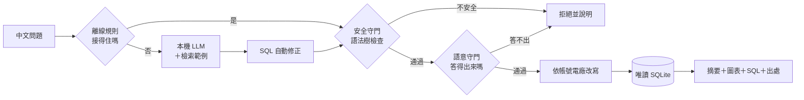

# GridLens TW｜用中文查台電資料的地端 Text2SQL 系統

> 用中文問台灣電力資料，系統產生 SQL、查詢並畫圖回答，同時告訴你「這份資料能不能支持這個答案」。
> **全程地端**：規則、檢索、語言模型都在自己的電腦上跑，不需要 API key，問句與資料不送到任何雲端服務。

> **English summary** — A local-first Text2SQL system for Taiwan Power Company open data. Questions in Chinese are answered
> by deterministic rules first; the long tail goes to a local LLM (Ollama, `qwen3:8b`). Every query passes an AST-based SQL
> guard and a semantic guard. I added a local LLM evaluation with a held-out set, and SQL repairs that raised held-out
> accuracy from 3/20 to 9/20. I also built a 10-minute realtime generation collector, dashboard and query path.


-1a5fb4)


## 重點

| 面向 | 成果 |
|---|---|
| 規則路徑（多數問題） | 意圖 80／80、執行 60／60、語意陷阱端到端 45／45，全部可重現、不需要模型 |
| 安全 | SQL 攻擊題 16／16 攔截、正常問題 0／20 誤攔；SQL 以語法樹檢查，權限在後端改寫 |
| 本機 LLM（規則答不出的長尾） | 在**沒調過的題庫**上答對 3 → **9／20**，沒有回答 4 → 0；兩次重跑結果相同 |
| 即時資料 | 每 10 分鐘收集台電 204 個機組的發電量，先封存再入庫，壞了能從封存重建 |
| 工程品質 | 1,329 項測試、CI 全程離線；每個改動都有可回退的紀錄（[log.md](log.md)） |

**技術**：Python、FastAPI、SQLite、sqlglot、Ollama（本機 LLM）、RAG（自寫字元 n-gram 檢索）、LLM guardrails、
評測設計（對照實驗、held-out 題庫）、pytest、GitHub Actions。

## 我負責的部分

這是團隊專題 [lee851104/text2sql_project](https://github.com/lee851104/text2sql_project) 的 fork。
資料對齊、Text2SQL 管線、雙層守門、帳號權限與資料治理的基礎由團隊完成；下面是我主導的部分，commit 紀錄都查得到。

**1. 本機 LLM：改成全程地端，並量出、改善它的準確率**
- 拿掉雲端模型，只保留本機 Ollama；三種執行模式（只用規則／一律用本機模型／偵測到才用），公開服務固定只用規則。
- 建立 LLM 評測：只收「規則答不出、資料答得出」的題目，執行模型的 SQL 與標準答案比對結果；
  另寫一份**從沒拿來調整過的 held-out 題庫**，避免只是對考題修。
- 用對照實驗找出瓶頸：推理開較準但慢 30 倍；RAG 開或關總分相同，不是準確率低的原因；
  逐次記錄模型的輸出後發現，它被退回時常把同一句 SQL 原樣再送。
- 依此設計 **SQL 自動修正**（[sql_repair.py](src/text2sql/sql_repair.py)）：只修正確寫法唯一的錯，例如 `LIMIT ?`、
  `縣市 = '高雄市'`（資料存的是「高雄市小港區」）、寫死在 SQL 裡的字串；有兩種以上改法時不猜。
  修過的 SQL 一樣要過所有守門。
- 試過但拿掉的：把「結果有重複列」等問題退回給模型，分數反而從 13 掉到 11。

**2. 即時發電：從收集、展示到用中文查**
- **收集器**：每 10 分鐘抓台電即時資料；排程避開發布延遲、條件式請求、失敗退避；原始回應雜湊去重封存，
  資料庫隨時能從封存重建且 checksum 相同；資料庫損壞、檔案被 Excel 存壞都能自動復原。
- **機組對照**：204 個即時機組的所屬電廠與粒度逐一人工確認，執行時不靠字串猜測。
- **即時面板**：燈號、各類型出力、今日趨勢；電廠帳號只看得到本廠，資料落後或異常都標在數字旁。
- **用中文查即時資料**：「現在風力發多少」改查即時資料庫並附資料時間；也匯入台電歷史資料回補過去的發電量。

**3. 擴充離線規則**：歲修排程、核能機組、再生能源的月份／縣市／場站篩選；發電成本題答不出來時說明原因，不硬答。

## 為什麼要守門

想問的人不會寫 SQL，會寫 SQL 的人不知道要問什麼。但只會翻譯還不夠：問「2025 年台灣太陽能發了多少度？」
查得到數字，可是那份資料只收台電**自建**場站，約佔全國的 **3～4%**，數字看起來完全正常，使用者不會察覺。
所以系統的重心在守門：算不出來的題目直接擋下並建議問法；答得出但有範圍限制的，照答並把限制寫在旁邊。

## 系統怎麼運作



- **規則先接**：大部分問題由離線規則直接產生 SQL，可重現、不需要模型；接不住的長尾才交給本機 LLM。
- **安全守門**：用 sqlglot 拆語法樹，只准查審核過的中文語意檢視、只准單一 SELECT、值一律走參數。
- **語意守門**：分「拒答／揭露限制／請你講清楚」三級，資料陷阱寫在資料庫裡，不靠提示詞。
- **權限在後端**：SQL 通過檢查後才依帳號改寫，模型想繞也繞不過去。
- **全程地端**：本機 Ollama 只連 `127.0.0.1`；檢索索引是 repo 裡的 JSON，不需向量服務；沒開 Ollama 時自動退回規則。

## 本機 LLM 評測

規則答不出的題目交給本機 `qwen3:8b`（推理關）。用兩份各 20 題的題庫量，比對的是查詢結果的值，不看欄名與順序：

| 題庫 | 修正前 | 現在 |
|---|---:|---:|
| **沒調過的題目**（[held-out](benchmarks/llm_holdout_questions.json)） | 3 | **9**（兩次重跑相同） |
| 拿來找錯誤的題目（[llm_questions](benchmarks/llm_questions.json)） | 5 | 15（照這份修過，偏樂觀） |

學到的三件事：

1. **推理開比較準，但慢 30 倍**（同一份題庫 10 題 vs 6 題，每題數分鐘 vs 十幾秒），所以預設關、需要時可切換。
2. **RAG 不是準確率低的原因**：關掉檢索範例總分不變，但有 7 題結果互換；字面相似的範例會把模型帶偏。
3. **能用程式改好的錯就直接改**：8B 模型被退回時常原樣再送，退回請它改幾乎沒用；修正程式只處理寫法唯一的錯。

結論是**本機 8B 模型在規則答不出的題目上大約答對一半**，剩下的錯要理解題意（例如問「有幾座」卻列出清單）。
完整實驗與每一步的數字見 [docs/LLM_EVALUATION.md](docs/LLM_EVALUATION.md)。

```bash
uv run --extra local python -m eval.llm_eval --questions holdout   # 需要先開 Ollama
```

## 即時發電


- 台電的即時端點只提供「現在」這一筆，錯過就沒了，所以收集器先把原始回應封存，再驗證、入庫。
- 面板的缺值顯示空白而不是 0，沒收到的時段斷線；收集器停止或資料落後時亮黃燈或灰燈。
- 問句帶「現在、今天、昨天」時改查即時資料庫；兩個資料庫的機組名稱沒有對照，所以不混在同一句 SQL。

## 資料治理與權限

- **電廠帳號**：帳號綁電廠，查詢與即時面板都只給本廠和跨廠共用的資料。
- **資料異動要兩個人**：上傳資料先建候選資料庫，必須由另一個有審核權的帳號核准才上線；可回退，稽核紀錄成雜湊鏈。
- **語料學習**：成功的查詢經六道檢查與人工核准，才成為新的檢索範例；評測題目不准進語料。

## 快速開始

**Windows**：點兩下 `啟動.bat`，瀏覽器會開在 <http://127.0.0.1:8765/>。要用本機模型，先裝 [Ollama](https://ollama.com) 並執行
`ollama pull qwen3:8b`；沒開 Ollama 時自動只用規則。要看即時發電，再點兩下 `即時收集啟動.bat`。

**開發者**（Python 3.12，用 [uv](https://docs.astral.sh/uv/) 管理）：

```bash
make setup && make db && make serve          # 安裝、建資料庫、啟動 http://127.0.0.1:8000
uv run powerquery "2026年7月備轉容量率最低是哪一天？"
make test-all && make eval                   # 全套測試與離線評測
```

程式內部沿用原專案名稱：指令 `powerquery`、環境變數 `POWERQUERY_*`。帳號、執行模式與資料管理見 [docs/SERVING.md](docs/SERVING.md)。

## 文件

| 想知道 | 看這裡 |
|---|---|
| 設計與踩過的坑 | [SPEC](docs/SPEC.md)、[log.md](log.md)（每一步的決定、驗證與回退方式） |
| 本機 LLM 評測 | [LLM_EVALUATION](docs/LLM_EVALUATION.md)、[評測](docs/EVALUATION.md)、[Text2SQL 管線](docs/TEXT2SQL_PIPELINE.md) |
| 守門 | [語意守門](docs/SEMANTIC_GUARD.md)、[系統卡](docs/SYSTEM_CARD.md) |
| 即時發電 | [來源分析](docs/REALTIME_INGEST.md)、[收集器規格](docs/superpowers/specs/2026-09-24-realtime-ingest-design.md) |
| 操作與 API | [SERVING](docs/SERVING.md)、[API 契約](src/serving/API_CONTRACT.md)、[公開服務](PUBLIC_OFFLINE_SERVING.md) |
| 資料 | [資料字典](docs/DATA_DICTIONARY.md)、[對齊方法](taipower_align/README.md) |

## 資料來源與授權

資料來自[政府資料開放平臺](https://data.gov.tw/)的八份台電資料集，依「[政府資料開放授權條款－第 1 版](https://data.gov.tw/license)」使用；
顯名與再散布規則見 [ATTRIBUTION.md](ATTRIBUTION.md)。程式與自寫文件以 [MIT 授權](LICENSE) 釋出，不涵蓋台電資料。

資料是固定時間取得的快照，即時資料可能落後或中斷，**不能作為供電或調度決策依據**；台電的顯名也不代表台電為本專案背書。
